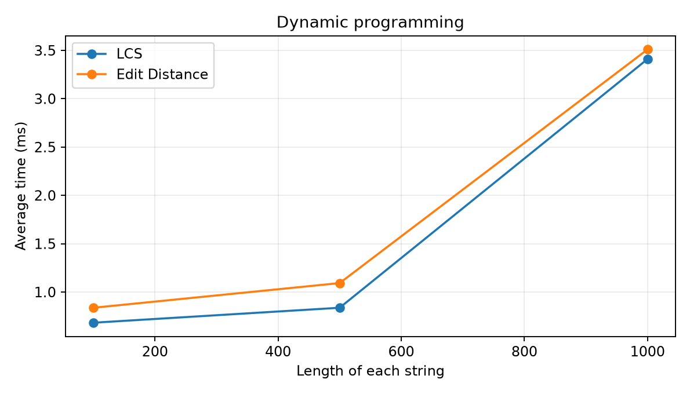
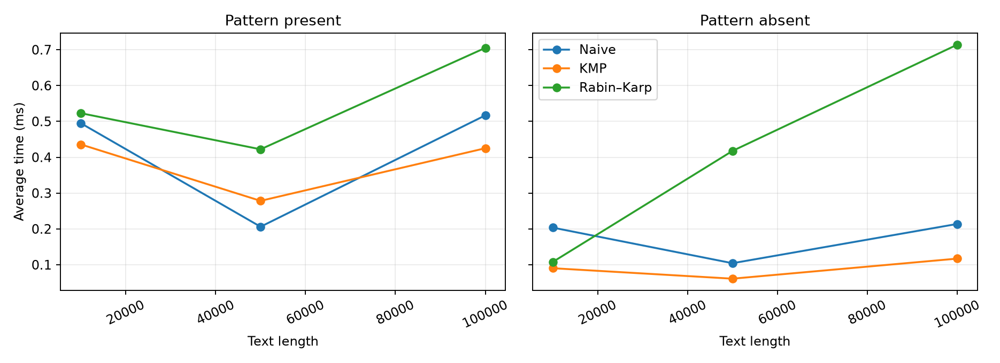

# Assignment 4 — Text Analysis

Java 21 project implementing LCS, Levenshtein edit distance, Naive search, KMP, Rabin–Karp, and Kasai's LCP algorithm

## How to run

1. Install JDK 21 and open the folder in IntelliJ IDEA.
2. Run `src/Tests`. Expected output: `Passed 21 tests`.
3. Run `src/Benchmark`. It creates/replaces `results/timings.csv`.

```
javac -d out src/*.java
java -cp out Tests
java -cp out Benchmark
```

To regenerate the two plots from `results/timings.csv`:

```
python plot_results.py
```

## Problem and algorithms

- LCS: dp[i][j] is the longest common subsequence length of the first i and j characters. Base case: dp[i][0] = dp[0][j] = 0. If the last characters match, dp[i][j] = 1 + dp[i-1][j-1]; otherwise dp[i][j] = max(dp[i-1][j], dp[i][j-1]). This is correct because a matched last character can extend a common subsequence, while for different last characters at least one is omitted from an optimal subsequence.
- Edit distance: dp[i][j] are the fewest edits for the first i and j characters. Base cases: dp[i][0] = i and dp[0][j] = j. The recurrence is min(dp[i-1][j]+1, dp[i][j-1]+1, dp[i-1][j-1]+cost), where cost is 0 for equal final characters and 1 otherwise. Every valid last edit is a deletion, insertion, or substitution/match, so taking the minimum yields the optimum.
- Naive: checks the pattern from left to right at every possible start index.
- KMP: computes the longest proper prefix that is also a suffix (lps) for each pattern prefix, then uses this table after mismatches instead of rechecking matched text. Overlapping matches are preserved.
- Rabin–Karp: uses a rolling polynomial hash (base 256, prime modulus 1,000,000,007). After equal hashes it compares the actual characters, so hash collisions never create false matches. Verification causes its worst-case slowdown.
- Kasai: given a suffix array sorted in lexicographic order, lcp[i] is the length of the common prefix of the suffixes at sa[i-1] and sa[i] lcp[0] = 0. An inverse-rank array locates each suffix. Moving one position forward can reduce its previous common prefix by at most one, so the running matched length is reused, giving linear total comparisons.

## Assumptions

- Strings are Java String values; matching and DP work with UTF-16 char units. Indices are zero-based UTF-16 offsets.
- An empty pattern occurs at every boundary, from index 0 through text.length() inclusive. A pattern longer than the text has no matches.
- All three search methods return every occurrence, including overlaps, in ascending order.
- Kasai receives a correctly lexicographically sorted suffix array. It validates that the array is a permutation, but not that its order is sorted. Suffix-array construction is outside its timed region.
- Random benchmark strings use alphabet ABCD and fixed seed 42. The present pattern has length 12 and is taken from the text midpoint. The absent pattern is ZZZZZZZZZZZZ, impossible under this alphabet.
- Search comparison counts cover text-versus-pattern character comparisons during search only. KMP preprocessing comparisons, Rabin–Karp hash arithmetic, and hash comparisons are excluded. -1 in the CSV means not applicable.

## Complexity analysis

Let m,n be the two DP string lengths; for search, n is text length and m is pattern length. Kasai uses n for string length. Space is auxiliary storage (not the input).

| Algorithm | Main operation / recurrence | Best time | Worst time | Auxiliary space | Reason |
|---|---|---|---|---|---|
| LCS | Match: diagonal + 1; else max(top, left) | O(mn) | O(mn) | O(mn) | Every table cell is filled once. |
| Edit Distance | Min(delete, insert, substitute/match) | O(mn) | O(mn) | O(mn) | Every table cell is filled once. |
| Naive | Compare pattern at every shift | O(n) for nonempty pattern with m ≤ n | O(nm) | O(1) excluding output | Immediate mismatch is cheap; repeated near-matches can scan the whole pattern at each shift. |
| KMP | LPS preprocessing, then fallback by LPS | O(m) preprocess + O(n) search | O(m) preprocess + O(n) search | O(m) excluding output | Pattern and text positions advance or fall back a bounded total number of times. |
| Rabin–Karp | Rolling hash, verify equal hashes | O(m) preprocess + O(n) expected search | O(m) preprocess + O(nm) search | O(1) excluding output | Constant-time hash update; frequent hash collisions or equal-window verifications can cost O(m) each. |
| Kasai | Rank lookup and extend/reuse common prefix | O(n) | O(n) | O(n) | The matched-prefix counter increases and decreases only O(n) times in total. |

For Naive, if m > n, search immediately returns in O(1). For an empty pattern, producing the required n+1 indices takes O(n) time and output space for every search method. All matching algorithms also use O(k) space for k returned indices. Rabin–Karp's expected O(n+m) assumes infrequent hash matches; worst-case collisions or genuine repeated matches make verification O(nm). These are theoretical bounds, not measured times.

## Correctness tests

Run `Tests.main()`: 21 checks passed.

| Algorithm | Cases checked |
|---|---|
| LCS | Identical, completely different, empty, standard mixed example |
| Edit distance | Identical, empty, substitution, insertion, deletion, kitten to sitting |
| All three matchers | Beginning, middle, end, multiple and overlapping occurrences, absent, longer pattern, empty pattern, empty text |
| Kasai | banana and empty string |

Manually checked example for banana:

| Suffix array index | Suffix start | Suffix | LCP with previous |
|---:|---:|---|---:|
| 0 | 5 | a | 0 |
| 1 | 3 | ana | 1 |
| 2 | 1 | anana | 3 |
| 3 | 0 | banana | 0 |
| 4 | 4 | na | 0 |
| 5 | 2 | nana | 2 |

Expected suffix array: [5, 3, 1, 0, 4, 2]; expected LCP: [0, 1, 3, 0, 0, 2].

## Experimental setup and method

Inputs are made once for each workload, outside timed regions. Each task has 3 untimed warm-up runs followed by 5 timed runs using System.nanoTime(); the reported time is the arithmetic mean in milliseconds. Console output and CSV writes are outside timing. The three search algorithms use the same text and pattern at each size/presence setting, and their outputs are checked for equality before timing. LCS and edit distance receive the same pair of random strings per size. Kasai receives a preconstructed suffix array, excluded from timing. No algorithm uses file I/O internally.

Timing is sensitive to JIT compilation, CPU load, and garbage collection, especially for short inputs; small non-monotonic differences are measurement noise. Run the benchmark again locally for measurements specific to your computer.

### LCS and edit distance

| String length (each) | LCS avg ms | Edit distance avg ms |
|---:|---:|---:|
| 100 | 0.6829 | 0.8376 |
| 500 | 0.8376 | 1.0928 |
| 1,000 | 3.4101 | 3.5097 |



### String matching

| Text length | Pattern | Naive ms | KMP ms | Rabin–Karp ms | Naive comparisons | KMP comparisons | Rabin–Karp comparisons |
|---:|---|---:|---:|---:|---:|---:|---:|
| 10,000 | Present | 0.4950 | 0.4358 | 0.5229 | 13,355 | 12,448 | 12 |
| 10,000 | Absent | 0.2036 | 0.0903 | 0.1077 | 9,989 | 10,000 | 0 |
| 50,000 | Present | 0.2060 | 0.2783 | 0.4221 | 66,555 | 61,645 | 12 |
| 50,000 | Absent | 0.1042 | 0.0611 | 0.4176 | 49,989 | 50,000 | 0 |
| 100,000 | Present | 0.5169 | 0.4251 | 0.7051 | 133,477 | 125,026 | 12 |
| 100,000 | Absent | 0.2138 | 0.1171 | 0.7141 | 99,989 | 100,000 | 0 |



The matching graph displays both present and absent cases. Rabin–Karp's recorded character comparisons are only those done during verification; its hashing work remains substantial even when that count is zero.

### Kasai

| String length | Average ms |
|---:|---:|
| 1,000 | 0.1269 |
| 5,000 | 0.2806 |
| 10,000 | 0.2759 |

The complete measurements and operation counts are in results/timings.csv.

## Discussion and conclusion

LCS and edit distance both fill an (m+1) × (n+1) table, so their measured time generally rises with input size, as predicted by O(mn), and their memory use is quadratic. Both solve different questions despite similar cost. Naive matching is concise and often fast for random data with early mismatches, but it can degrade to O(nm). KMP gives a worst-case linear bound through LPS fallback. Rabin–Karp has efficient rolling updates and expected linear searching, but hash verification can become expensive in the worst case. The observed timing does not have to follow Big-O rankings at small sizes due to constants and JVM effects. Kasai's linear pass is fast, but it requires a precomputed suffix array; suffix-array construction costs are not included. In practice, choose Naive for simplicity on small inputs, KMP for dependable search bounds, Rabin–Karp when hashing is useful, and Kasai when a suffix array is already available.